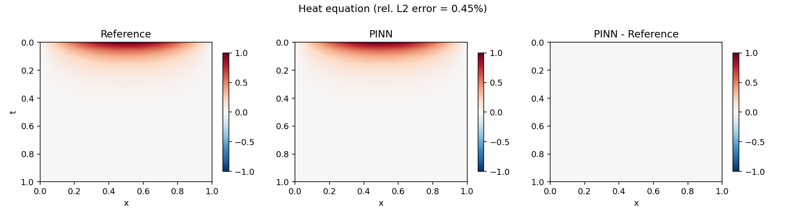
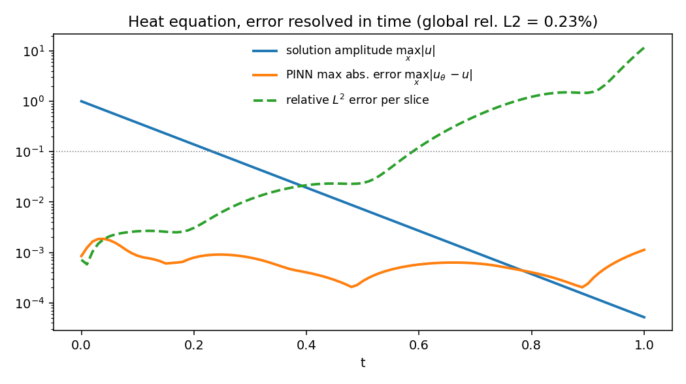
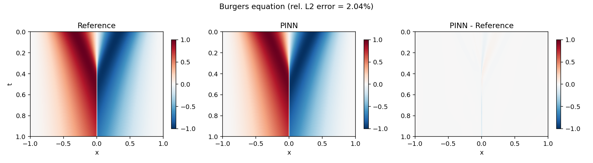
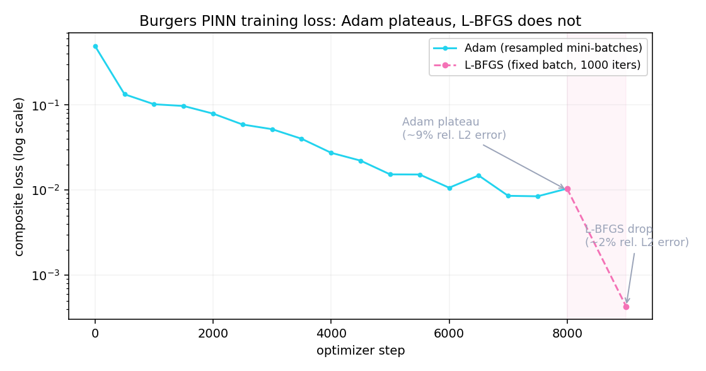
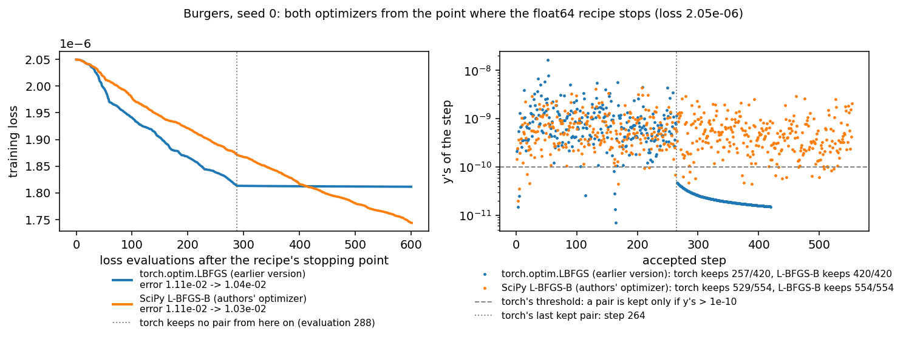

# Physics-Informed Neural Networks (PINNs)

[](https://github.com/crozol/04-pinns/actions/workflows/tests.yml)
[](https://opensource.org/licenses/MIT)
[](https://crozol.github.io/projects/04-pinns.html)
[](https://doi.org/10.5281/zenodo.24393856)

**TL;DR** — Two PDEs solved with physics-informed neural networks (Raissi, Perdikaris & Karniadakis, 2019): the loss combines the PDE residual, computed via automatic differentiation at collocation points, with the initial/boundary conditions — no mesh, no training data beyond those conditions. The 1D heat equation reaches **0.14% ± 0.05%** relative L2 error across 5 seeds against its closed-form solution (Adam + a short L-BFGS pass; 0.23% in the frozen run of the figures), but that is a global figure: the PINN's absolute error stays near `10⁻³` while the solution decays by `5 × 10⁻⁵`, so the relative error per time slice passes 10% after `t ≈ 0.6` (Section 4). The 1D viscous Burgers equation (`nu = 0.01/pi`, the classic benchmark with a thin internal layer at `x = 0`) is harder: Adam alone plateaus at **~8.8%**; L-BFGS fine-tuning on a fixed point batch brings it to **1.66% ± 0.49%** across 5 seeds (1.78% in the frozen run) against the exact Cole-Hopf solution. Getting there surfaced a silent failure mode of L-BFGS with resampled collocation points (Section 5.4). The Burgers result is sensitive to the untuned boundary-loss weight (Section 8). The original paper reports 0.067% on Burgers. Its recipe as released — SciPy's L-BFGS-B with the authors' options, in float32 — stays above `10⁻³` on all 20 seeds and never reaches that number (95% CI for the rate: 0–17%); the same recipe in float64 reaches it on 4 of 20. The final training loss does not tell good runs from bad ones; the residual on a fresh grid, computed without the exact solution, does (Spearman ρ = 0.54–0.58), and keeping the best of 5 seeds by it leaves 13% of float64 picks above `10⁻³` (bootstrap 95% interval 1–46%), against 50% of single runs (Section 9). Stack: PyTorch (autograd, `torch.optim.LBFGS`) · SciPy (L-BFGS-B for the paper's recipe, reference solutions) · NumPy · Matplotlib.

The document walks through both cases in the order they were actually solved —
including the point where the obvious approach quietly didn't work — rather
than only presenting the final, polished numbers.

---

## Contents

1. [Objective](#1--objective)
2. [Equipment (software stack)](#2--equipment-software-stack)
3. [Background: what is a physics-informed neural network?](#3--background-what-is-a-physics-informed-neural-network)
4. [The heat equation](#4--the-heat-equation)
5. [The Burgers equation](#5--the-burgers-equation)
   - [5.1 · Formulation](#51--formulation)
   - [5.2 · A numerical cross-check — why finite differences failed](#52--a-numerical-cross-check--why-finite-differences-failed)
   - [5.3 · First attempt: Adam alone](#53--first-attempt-adam-alone)
   - [5.4 · Diagnosing the plateau — and a silent L-BFGS failure](#54--diagnosing-the-plateau--and-a-silent-l-bfgs-failure)
   - [5.5 · The fix and the final result](#55--the-fix-and-the-final-result)
6. [Head-to-head: why Burgers is harder](#6--head-to-head-why-burgers-is-harder)
7. [Robustness: does it hold across seeds?](#7--robustness-does-it-hold-across-seeds)
8. [Sensitivity to the boundary weight](#8--sensitivity-to-the-boundary-weight)
9. [Comparison with the original paper](#9--comparison-with-the-original-paper)
   - [9.1 · What the authors ran](#91--what-the-authors-ran)
   - [9.2 · First attempt: `torch.optim.LBFGS`, a second silent stall](#92--first-attempt-torchoptimlbfgs-a-second-silent-stall)
   - [9.3 · Why the authors' optimizer, and not a patched torch](#93--why-the-authors-optimizer-and-not-a-patched-torch)
   - [9.4 · Result](#94--result)
   - [9.5 · Telling a good run from a bad one](#95--telling-a-good-run-from-a-bad-one)
   - [9.6 · Remaining differences](#96--remaining-differences)
10. [Reproducing](#10--reproducing)
11. [File map](#11--file-map)
12. [References](#12--references)

---

## 1 · Objective

Train a neural network `u_θ(x, t)` to satisfy a partial differential equation
directly — not by fitting it to a numerically-solved dataset, but by making
the PDE itself part of the loss function, evaluated via automatic
differentiation. Validate the result against a reference with no ambiguity
about ground truth: the closed-form solution for the heat equation, and the
exact Cole-Hopf solution for Burgers (an integral representation evaluated by
quadrature), with an independent Chebyshev-spectral solver as a cross-check.

## 2 · Equipment (software stack)

| Component | What it does in this experiment |
|---|---|
| Python 3.11+, PyTorch | The network and `torch.autograd.grad` for exact partial derivatives |
| `torch.optim.Adam` | First-order optimizer, resampled mini-batches every step |
| `torch.optim.LBFGS` | Second-order fine-tuning, strong-Wolfe line search |
| NumPy | Exact Cole-Hopf solution for Burgers (trapezoid quadrature) |
| SciPy (`solve_ivp`, `qmc`, `optimize`) | Chebyshev-spectral cross-check for Burgers; Latin-hypercube sampling and L-BFGS-B in the paper reproduction |
| Matplotlib | Static figures |

No GPU is needed. Heat training takes a few minutes on a modern laptop CPU;
Burgers (Adam + L-BFGS) takes roughly 15.

## 3 · Background: what is a physics-informed neural network?

A PINN is a neural network `u_θ(x, t)` whose loss combines three pieces:

1. **Initial condition** — `u_θ(x, 0)` must match the known state at `t = 0`.
2. **Boundary condition** — `u_θ` must match known values at the edges of the
   spatial domain, for all `t`.
3. **PDE residual** — at randomly sampled interior points ("collocation
   points"), the PDE itself, evaluated using the network's own partial
   derivatives, should equal zero.

Each piece is a mean squared error over its own set of points, and the loss
is their weighted sum,

```
L = L_PDE + λ_B · L_boundary + λ_I · L_initial
```

with `λ_I = 1` for both equations and `λ_B = 2` (the boundary term is the
mean over both edges, weighted twice). Section 7 measures how sensitive the
Burgers result is to `λ_B`.

The key trick is `torch.autograd.grad(u, x, create_graph=True)`: since `u` is
the network's output and `x` is one of its inputs, this computes `∂u/∂x`
*exactly* (to float32 precision), not by finite differences — and because
`create_graph=True` keeps the computation differentiable, the same call can be
applied again to get `∂²u/∂x²`. This is why `pinn.py` uses `Tanh` activations
throughout: `ReLU` has a zero second derivative almost everywhere, which would
make any PDE residual involving a second-order term (both equations here)
collapse to a useless constant.

The network never sees a numerically-solved trajectory. Everything it learns
comes from the IC/BC data points and the PDE residual at randomly sampled
interior points — the physics *is* the training signal.

## 4 · The heat equation

`u_t = alpha · u_xx` on `x ∈ [0, 1]`, `t ∈ [0, 1]`, `alpha = 1`, with
`u(x, 0) = sin(pi x)` and `u(0, t) = u(1, t) = 0`. This is the textbook case:
separation of variables gives the exact solution in closed form,

```
u(x, t) = sin(pi x) · exp(-pi² alpha t)
```

a single decaying mode, smooth everywhere, nothing stiff or thin to resolve.
It is the sanity check that the PINN machinery — the residual, the autograd
chain, the composite loss — is wired correctly before attempting something
harder.

Adam, 5000 epochs, 10k collocation points, reaches **0.45% relative L2
error** on its own — already well past the <1% target, with no second-order
fine-tuning needed. The frozen run below adds a short L-BFGS pass anyway
(for consistency with the Burgers pipeline in `main.py`), which pushes it
further to **0.23%**:



The rightmost panel — the pointwise difference between the PINN and the
exact solution — is essentially blank on a colour scale set by the initial
amplitude.

That global number needs a qualification. The solution decays by a factor
`exp(-pi²) ≈ 5 × 10⁻⁵` over `t ∈ [0, 1]`, so a single relative L2 error over
the whole space-time grid is dominated by the early times, where `u` is of
order one. Resolving the error in time (`scripts/heat_time_error.py`) shows
what actually happens: the PINN's **absolute** error stays roughly constant,
below `1.9 × 10⁻³` at every `t`, while the solution keeps shrinking. The
**relative** error per time slice is 0.07% at `t = 0`, 1.1% at `t = 0.3` and
2.4% at `t = 0.5`, crosses 10% at `t ≈ 0.59`, and exceeds 100% from `t ≈ 0.8`
on, where `|u|` has fallen below the network's error floor.



The PINN therefore approximates the solution to a fixed absolute accuracy,
not a fixed relative one; the 0.23% figure describes the first half of the
time window well and the second half not at all.

## 5 · The Burgers equation

### 5.1 · Formulation

`u_t + u·u_x = nu·u_xx` on `x ∈ [-1, 1]`, `t ∈ [0, 1]`, `nu = 0.01/pi`, with
`u(x, 0) = -sin(pi x)` and `u(-1, t) = u(1, t) = 0` — the standard benchmark
from the original PINN paper (Raissi et al., 2019). The nonlinear advection
term `u·u_x` steepens the odd initial condition toward `x = 0` as `t`
increases; the small viscosity `nu` keeps the solution smooth but confines
that steepening to a thin internal layer rather than letting it form a true
discontinuity.

The equation does have an exact solution. The Cole-Hopf substitution
`u = -2 nu ∂_x ln φ` turns it into the heat equation for `φ`, and for this
initial condition (Basdevant et al., 1986)

```
u(x, t) = ∫ (η/t) w(x, η, t) dη / ∫ w(x, η, t) dη,
w(x, η, t) = exp( -cos(pi (x - η)) / (2 pi nu) - η² / (4 nu t) ).
```

The integrals have no elementary closed form, but the Gaussian factor
confines them to `|η| ≲ 12 √(4 nu t)`, and the trapezoid rule on 8001 nodes
evaluates them to roundoff (`src/reference.py::burgers_exact`). On the
256 × 100 evaluation grid, against 16001 nodes (`scripts/reference_convergence.py`):

| Nodes | Relative L2 change | Max. change |
|---|---|---|
| 1001 | 9.9 × 10⁻¹⁵ | 3.4 × 10⁻¹³ |
| 2001 | 2.5 × 10⁻¹⁵ | 8.4 × 10⁻¹⁴ |
| 4001 | 6.2 × 10⁻¹⁶ | 2.0 × 10⁻¹⁴ |
| 8001 | 2.5 × 10⁻¹⁶ | 4.1 × 10⁻¹⁵ |

Widening the window from 12 to 16 Gaussian widths changes the field by
`2.6 × 10⁻¹⁶`. Two independent checks: the computed field satisfies the PDE
with a finite-difference residual of `4 × 10⁻¹⁰`, and its maximum slope,
`|u_x(0, t)| = 152.00516` at `t = 1.6037/pi` (from the same integrals
differentiated under the integral sign), matches the value published by
Basdevant et al. (1986) to all the digits they give. Every Burgers error
reported below is measured against this solution; its own error, `~10⁻¹⁶`,
is negligible next to any of them.

### 5.2 · A numerical cross-check — why finite differences failed

The project first validated Burgers against a numerical solution, before
switching to the exact one above; that solver is kept as an independent
cross-check, and building it had its own failure worth recording. The first
attempt was the obvious one: discretize `x` on a uniform grid, use central
differences for `u_x` and `u_xx`, and integrate in `t` with a stiff implicit
solver (`scipy.integrate.solve_ivp`, method `Radau`). On a 201-point grid the
integration ran in under a second — and produced `max|u| ≈ 1.51`.

That number is wrong on its own terms: `u_t + u·u_x = nu·u_xx` is a parabolic
PDE with no source term, so the maximum principle guarantees
`max|u(·, t)| ≤ max|u(·, 0)| = 1` for every `t`. An overshoot above `1` is not
a borderline numerical-error case — it is a sign the discretization itself is
invalid. The cause: `nu = 0.01/pi ≈ 0.00318` is small, so the internal layer
that forms near `x = 0` is only a few thousandths of a unit wide — thinner
than the grid spacing could resolve. A central-difference stencil on a
too-coarse grid produces exactly this kind of spurious oscillation (Gibbs-type
ringing) near a thin feature it cannot see clearly.

The fix was to stop discretizing locally. A **Chebyshev spectral method**
(`src/reference.py`) differentiates via a global polynomial interpolant
instead of a local stencil, so it does not need the grid to be locally finer
than the feature — spectral differentiation converges exponentially for
smooth functions regardless of where a sharp-but-smooth feature sits. With
`N = 256` points, the same maximum-principle check now gives `max|u| ≈ 0.9999`
— inside the physical bound, as it must be — and the solution is odd-symmetric
(`u(-x, t) = -u(x, t)`) and exactly zero at the boundaries to machine
precision, both properties guaranteed by the problem's symmetry and checked
directly in `tests/test_physics.py`.

Compared with the exact solution, the spectral solution has a relative L2
error of **0.40%** (maximum pointwise error 0.035, inside the internal layer).
That is small in absolute terms but only a factor of ~5 below the PINN's own
error, which is why the reported numbers now use the exact solution instead.
The 0.40% is spatial under-resolution, not interpolation (the comparison is
on the solver's own nodes): Gauss-Lobatto nodes cluster at the boundaries and
are sparsest at `x = 0`, with spacing `≈ pi/N` — for `N = 256`, `0.0123`,
about twice the width of the layer at its steepest (`1/152 ≈ 0.0066`). The
largest error sits at the node next to `x = 0` at `t ≈ 0.52`, when the layer
is steepest, and doubling `N` removes most of it:

| N | Spacing at x = 0 | Relative L2 error | Max. error |
|---|---|---|---|
| 128 | 0.0245 | 2.06% | 0.11 |
| 256 | 0.0123 | 0.40% | 0.035 |
| 512 | 0.0061 | 0.013% | 0.0014 |
The 8.8% and 1.92% figures in Sections 5.3–5.5 are from the original
validation against this spectral solution and are labelled as such.

### 5.3 · First attempt: Adam alone

Same recipe as the heat equation — Adam, 8000 epochs, 10k collocation points,
resampled every step — applied to the harder problem:

```
[epoch      0] loss=4.932933e-01
[epoch   4000] loss=2.744396e-02
[epoch   8000] loss=1.040192e-02   (final)
```

Evaluated against the spectral reference: **relative L2 error ≈ 8.8%** — above
the 5% target, and the loss curve (Section 6 has the full plot) is not
smoothly converging by the end; it oscillates around `~0.01` instead of
continuing to drop. Something was leaving real accuracy on the table.

### 5.4 · Diagnosing the plateau — and a silent L-BFGS failure

Raissi et al.'s original paper does not stop at Adam: it follows a first-order
warm-up with **L-BFGS**, a quasi-Newton method whose curvature information
lets it take much larger, better-aimed steps near a minimum than Adam's
per-parameter first-order updates can. `torch.optim.LBFGS` was added
(`src/train.py::refine_lbfgs`) and pointed at the already-Adam-trained model.

The first run of this looked like it worked — the closure reported a loss of
`6.46 × 10⁻³`, well below Adam's `1.04 × 10⁻²` — but the relative L2 error
against the reference came back **identical to 15 significant figures**
(`0.08827312736777508`, both times) to the pre-refinement number. The model
had not actually changed at all.

The cause: `torch.optim.LBFGS` with `line_search_fn="strong_wolfe"` searches
for a step size by evaluating the loss (and its gradient) at several candidate
points, and both the line search and the quasi-Newton Hessian approximation
assume the objective is a **deterministic** function of the parameters —
evaluating it twice at the same point must return the same value. The
training loop's `loss_fn`, by design, resamples a fresh batch of collocation,
boundary and initial points on *every* call (ordinary and correct for Adam's
stochastic mini-batch training). Under L-BFGS that same design turns the
objective into a noisy function: the line search's step-size probes see
different random realizations of the loss at each trial point, can never
reliably satisfy the Wolfe conditions, and the step is effectively rejected —
silently, with no exception, no warning, just an optimizer that reports an
interesting intermediate number and then changes nothing. The giveaway was
exactly that bit-for-bit-identical error: a coincidence that precise does not
happen from two different training runs landing on the same loss basin — it
happens when the parameters never moved.

### 5.5 · The fix and the final result

The fix: sample one large batch of collocation, boundary and initial points
**once**, before calling L-BFGS, and reuse that exact batch on every internal
evaluation of the closure during the refinement step. This makes the
objective deterministic for as long as L-BFGS runs, which is what both the
line search and the curvature estimate require (`src/train.py` — `train_heat`
and `train_burgers` both take an `lbfgs_iter` argument that triggers this
fixed-batch refinement after the stochastic Adam phase).

With that single change, 1000 L-BFGS iterations on a fixed batch of 40k
collocation / 800 boundary / 800 initial points:

```
[L-BFGS] final loss = 4.525385e-04
```



**Relative L2 error: 1.78%** against the exact solution on the 256 × 100 grid
of Raissi et al. (1.92% against the spectral solution; target was <5%), down
from ~8.8% with Adam alone. The error map (rightmost panel) is now concentrated almost entirely in
a thin vertical band right at the internal layer — exactly where the solution
is hardest to represent — rather than spread across the domain, which is the
qualitative signature of a method that is working correctly but running into
a genuinely hard local feature, not one that is broken.

## 6 · Head-to-head: why Burgers is harder



The heat equation's loss (not pictured — it simply decays smoothly to
`6.7 × 10⁻⁵` with Adam alone, then to `3.1 × 10⁻⁶` after the same short
L-BFGS pass) never *needed* the second optimizer the way Burgers did. Two
things make Burgers
different: the nonlinear `u·u_x` term couples every collocation point's
residual to the local value and slope of `u` itself, unlike the heat
equation's linear residual; and the thin internal layer concentrates nearly
all of the PDE's "information content" into a small region of the domain,
which first-order per-parameter updates are slow to resolve. Both are
well-documented properties of the Burgers benchmark in the PINN literature,
not an artifact of this particular implementation — which is exactly why
Raissi et al.'s original recipe already includes the L-BFGS stage this
project needed to rediscover.

## 7 · Robustness: does it hold across seeds?

Every number above comes from one frozen run (seed 0). Training is genuinely
stochastic — collocation points resample every Adam step, the L-BFGS fixed
batch is itself a random draw, and the network's initial weights depend on
the seed — so a single run could in principle be a lucky draw. `scripts/seed_sweep.py`
retrains each PINN end-to-end (full Adam + L-BFGS pipeline) across 5
independent seeds, mirroring the n=5 seed error bars used for the Neural
ODEs project (02):

**Heat equation** — mean ± std: **0.14% ± 0.05%** (range 0.10%–0.23%)

| seed | 0 | 1 | 2 | 3 | 4 |
|---|---|---|---|---|---|
| relative L2 error | 0.23% | 0.13% | 0.10% | 0.14% | 0.12% |

**Burgers equation**, against the exact solution — mean ± std: **1.66% ± 0.49%**
(range 1.05%–2.33%)

| seed | 0 | 1 | 2 | 3 | 4 |
|---|---|---|---|---|---|
| relative L2 error | 1.88% | 1.66% | 1.34% | 2.33% | 1.05% |

Both equations clear their targets (<1% heat, <5% Burgers) on *every* one of
the 5 seeds, not just the featured run. For heat, seed 0 is the worst of the
five; for Burgers it sits in the middle, and the frozen run (1.78%) is close
to the mean. The heat errors are global over `t ∈ [0, 1]` and inherit the
qualification of Section 4. Seed 0 retrained here gives 1.88% rather than the
frozen run's 1.78% because training is not bit-for-bit reproducible
(Section 10); the difference is well inside the seed-to-seed spread.

```bash
python -m scripts.seed_sweep --equation heat --seeds 5
python -m scripts.seed_sweep --equation burgers --seeds 5
```

## 8 · Sensitivity to the boundary weight

Uniform loss weights are a known weak point of PINNs: the terms compete
during training, and their relative scale shapes what the optimizer fits
first (Wang, Teng & Perdikaris, 2021). The weight `λ_B = 2` used throughout
was not tuned — it is what the original code did implicitly, summing the two
per-edge means. `scripts/bc_weight_sweep.py` retrains the Burgers PINN (seed 0,
full Adam + L-BFGS pipeline) for four values of `λ_B` and chooses among them
without the exact solution. On a fresh regular grid (201 × 101 interior
points, 101 boundary times per edge, 201 initial points, none of them used in
training) it computes the unweighted validation loss

```
V = mean r_PDE² + mean u(±1, t)² + mean (u(x, 0) + sin πx)²
```

with weight 1 on each term whatever `λ_B` was used in training, and selects
the smallest:

| `λ_B` | 0.5 | 1 | 2 (used) | 4 |
|---|---|---|---|---|
| validation loss `V` | 1.90 × 10⁻⁴ | 3.27 × 10⁻⁴ | 4.53 × 10⁻⁴ | 3.35 × 10⁻⁴ |
| relative L2 error vs. exact | 0.86% | 1.31% | 1.78% | 1.67% |

The criterion selects `λ_B = 0.5`, whose error against the exact solution is
**0.86%**, about half that of the untuned `λ_B = 2`. That error is reported
once, after the choice; the other errors are shown for transparency, not for
selection. `V` orders the four weights as the exact error does, but on its own
this is weak evidence: a random order of four matches with probability
1/24 ≈ 0.04, it is a single seed, and the seed-to-seed spread at fixed `λ_B`
(Section 7) is of the same order as some of these differences. Section 9.5
tests the same criterion on the 40 runs of the paper's recipe, where it does
rank the errors (Spearman ρ = 0.54 and 0.58). This run gives 1.78% at
`λ_B = 2`, the frozen run's value, where an earlier run of the same sweep gave
1.88% (training is not bit-for-bit reproducible, Section 10). The frozen
configuration stays at the untuned `λ_B = 2`, so that every number before this
section comes from the same setup.

```bash
python -m scripts.bc_weight_sweep --weights 0.5 --out results/bc_sweep/w0.5.json   # one process per weight
python -m scripts.bc_weight_sweep --summarize                                      # select over results/bc_sweep/
```

## 9 · Comparison with the original paper

Raissi et al. (2019) report a relative L2 error of `6.7 × 10⁻⁴` (0.067%) on this benchmark,
about 25 times lower than the 5-seed mean above. This section measures how often their recipe
reaches that number: the quantity reported is the failure rate over 20 seeds — how many runs
stay above `10⁻³`, with an exact 95% interval — rather than a single run or a median.

### 9.1 · What the authors ran

The recipe is taken from the authors' released code
(`appendix/continuous_time_inference (Burgers)/Burgers.py`, TensorFlow 1.x), not only from the
text of the paper:

- a tanh network with 8 hidden layers of 20 neurons (3 021 parameters) in **float32** — the
  paper's "9 layers" counts the output layer. The input `(x, t)` is mapped to `[−1, 1]²` before
  the first layer, and the weights are Xavier draws from a truncated normal;
- `N_u = 100` initial/boundary points and `N_f = 10 000` Latin-hypercube collocation points, on
  the bounding box of the authors' data grid: `x ∈ [−1, 1]`, `t ∈ [0, 0.99]`. Their grid's last
  time is 0.99, so the input scaling, the points and the error grid all stop there; an earlier
  version of this port used `t ∈ [0, 1]`;
- loss `MSE_u + MSE_f`, minimised by **SciPy's L-BFGS-B** through TensorFlow's
  `ScipyOptimizerInterface` with `maxiter = maxfun = 50 000`, `maxcor = 50`, `maxls = 50` and
  `ftol = ε`. The call does not set `gtol`, so SciPy's default applies: a run also stops when
  the largest gradient component falls below `10⁻⁵`. TensorFlow passes these options through
  unchanged and only casts the float32 gradient to float64.

There is no Adam phase. `scripts/raissi_repro.py` builds the same network in PyTorch and calls
the same optimizer with the same options.

Every error in this section is measured against the Cole-Hopf solution on the paper's 256 × 100
grid; that reference is converged to `2.5 × 10⁻¹⁶` (Section 5.1), twelve orders of magnitude
below the smallest error reported here. The authors measured theirs against a numerical solution
shipped with their code; the two references agree to `3.1 × 10⁻¹²` (Section 9.6).

### 9.2 · First attempt: `torch.optim.LBFGS`, a second silent stall

The first version of this reproduction followed the paper's text — read as 9 hidden layers
(3 441 parameters), one more than the authors' code — with `torch.optim.LBFGS` in float64
(history 50, strong-Wolfe line search, stopping tolerances set near zero so that the evaluation
budget would decide). On three seeds it gave `7.1 × 10⁻⁴`, `1.15 × 10⁻³` and
`2.2 × 10⁻²`, each run using its full budget of 62 501 loss evaluations (~8 h per seed).
Extending it to 20 seeds exposed what those runs had been doing in their second half: checkpoints
taken hours apart held the same curvature memory, and the optimizer had become a fixed-metric
descent alternating between two step sizes and lowering the loss by about `10⁻¹²` per
iteration.

The cause is the test that decides whether a step's curvature pair `(s, y)` enters the memory.
`torch.optim.LBFGS` keeps it only if `yᵀs > 10⁻¹⁰`, an absolute threshold. Near a loss of
`10⁻⁶` the steps become small enough that `yᵀs` falls below it, to `10⁻¹¹`–`10⁻¹²`, and from
then on every new pair is discarded, although each one is valid curvature information:
`yᵀs / (−gᵀs)` stays at 1.00, fifteen orders of magnitude above machine precision. The memory
does not recover, since without new pairs the steps stay small. As in Section 5.4, nothing
reports the failure; the loss keeps decreasing, only about 70 times more slowly than under
L-BFGS-B (table below).

`scripts/lbfgs_memory_test.py` reproduces this from scratch: it runs the recipe in float64 until
it stops, then gives both optimizers the same 600 loss evaluations from that point. On seed 0,
torch works normally for 288 evaluations, faster than L-BFGS-B, until at a loss of
`1.81 × 10⁻⁶` its `yᵀs` falls below the threshold; it keeps no pair after step 264 (dotted line
in the figure).

| from the point where the recipe stops (seed 0, loss `2.05 × 10⁻⁶`) | `torch.optim.LBFGS` | SciPy L-BFGS-B |
|---|---|---|
| pairs kept by torch's test, `yᵀs > 10⁻¹⁰` | 257 / 420, none after step 264 | 529 / 554 |
| pairs kept by L-BFGS-B's test, `yᵀs > ε·(−gᵀs)` | 420 / 420 | 554 / 554 |
| loss decrease per evaluation, evaluations 1–288 | `8.2 × 10⁻¹⁰` | `6.2 × 10⁻¹⁰` |
| loss decrease per evaluation, evaluations 289–600 | `5.5 × 10⁻¹²` | `4.1 × 10⁻¹⁰` (74 times) |
| relative L2 error against the exact solution | `1.11 × 10⁻²` → `1.04 × 10⁻²` | `1.11 × 10⁻²` → `1.03 × 10⁻²` |

Measured from the same loss instead of over the same evaluations (L-BFGS-B reaches
`1.81 × 10⁻⁶` at evaluation 411), the ratio is 66. Before the domain was corrected
(Section 9.1), the same test froze torch's memory from its first step (0 of 300 pairs kept):
where the freeze sets in depends on the starting point.



### 9.3 · Why the authors' optimizer, and not a patched torch

Lowering torch's threshold removes the stall, but three reasons favour running the authors'
optimizer instead:

1. **The question is about the recipe.** A failure rate describes a procedure. If the
   optimizer, its stopping rule or the precision differ from the authors', the rate belongs to
   a different procedure and says nothing about the published number.
2. **The memory test is not the only difference.** L-BFGS-B (Byrd, Lu, Nocedal & Zhu, 1995)
   skips a pair when `yᵀs ≤ ε·(−gᵀs)`, a test relative to the step, so it does not depend on
   the units of the loss: on a quadratic multiplied by `2⁻⁴⁰`, torch stores no pair and does not
   progress, while L-BFGS-B stores the same pairs and reaches the same loss
   (`tests/test_raissi_repro.py`). The two also differ in line search (Moré–Thuente vs. a
   bracketing cubic search) and in their stopping tests. A patched torch would match neither
   its own library nor the paper.
3. **Where a run stops decides what it reports.** At this level the training loss no longer
   tracks the error: across the 20 float64 runs the final loss does not rank the errors
   (Spearman ρ = 0.11, p = 0.63; Section 9.4), and from seed 0's stopping point 600 more
   evaluations of L-BFGS-B lower the loss by 15% while the error moves from `1.11 × 10⁻²` to
   `1.03 × 10⁻²`. The stopping rule (`gtol = 10⁻⁵`, `ftol = ε`) is therefore part of the
   recipe — and the torch runs, which kept going far past it, were measuring something else.

### 9.4 · Result

| | float32 (the authors' precision) | float64 |
|---|---|---|
| runs above `10⁻³` [95% CI] | **20 / 20** [83, 100%] | 10 / 20 [27, 73%] |
| runs at or below the published `6.7 × 10⁻⁴` [95% CI] | 0 / 20 [0, 17%] | 4 / 20 [6, 44%] |
| median relative L2 error [IQR] | `2.0 × 10⁻³` [`1.4 × 10⁻³`, `5.7 × 10⁻³`] | `1.15 × 10⁻³` [`7.0 × 10⁻⁴`, `2.1 × 10⁻³`] |
| best / worst seed | `1.17 × 10⁻³` (seed 19) / `3.5 × 10⁻²` (seed 7) | `4.6 × 10⁻⁴` (seed 4) / `6.0 × 10⁻³` (seed 16) |
| stopped by | relative reduction (`ftol`) in 19 of 20, gradient (`gtol`) in 1 | gradient (`gtol`) in 20 of 20 |
| median loss evaluations | 5 496 of 50 000 | 7 095 of 50 000 |

The intervals are exact (Clopper-Pearson) binomial intervals. With the authors' optimizer,
options and precision, no seed reaches the published `6.7 × 10⁻⁴` and all 20 stay above `10⁻³`;
the best, seed 19, is at `1.17 × 10⁻³`. At 95% confidence a float32 run reaches the published
value less than 17% of the time, so either the published run was rarer than about 1 in 6 or a
difference of implementation remains (Section 9.6). Nineteen of the 20 runs end on the `ftol`
test long before their budget, with the largest gradient component still above `gtol` (median
`8.5 × 10⁻⁵`). That test is `(f_k − f_{k+1}) / max(|f_k|, |f_{k+1}|, 1) ≤ ε`; below a loss of 1
it asks for a decrease smaller than `ε ≈ 2.2 × 10⁻¹⁶`, which in float32 means a decrease the
loss can no longer represent. A run therefore stops when float32 stops resolving its progress,
not when it has converged. Across seeds the final loss (`2.6 × 10⁻⁶`–`2.5 × 10⁻⁵`) does not
rank the errors (Spearman ρ = 0.04, p = 0.86).

In float64 the same recipe runs until the gradient test is met, uses about 30% more evaluations
and does better on 16 of 20 seeds: 4 runs reach the published error, which lies just below the
lower quartile. Even so, half the runs stay above `10⁻³`, with a final loss no different from
the best ones: across the float64 seeds the final loss (`1.3`–`2.6 × 10⁻⁶`) does not rank the
errors either (Spearman ρ = 0.11, p = 0.63).

A seed takes about 10 min in float32 and 15–20 min in float64 on a laptop CPU, run alone.

### 9.5 · Telling a good run from a bad one

The training loss cannot tell the good runs from the bad ones, but the validation loss `V` of
Section 8 can. `V` is the unweighted residual of the PDE, boundary and initial conditions on a
fresh regular grid over the authors' domain (201 × 101 interior points, 101 boundary times per
edge, 201 initial points), so it needs no exact solution.

| | float32 | float64 |
|---|---|---|
| Spearman ρ of `V` against the error (p) | 0.58 (0.007) | 0.54 (0.014) |
| Spearman ρ of the final training loss against the error (p) | 0.04 (0.86) | 0.11 (0.63) |
| error of the run with the lowest `V` (rank among 20) | `1.25 × 10⁻³` (2nd) | `4.6 × 10⁻⁴` (1st) |

Keeping, among several seeds, the run with the lowest `V` is therefore a selection rule that
needs no reference solution. Over all 15 504 sets of 5 of the 20 float64 runs, the kept run has
a median error of `7.2 × 10⁻⁴`, reaches the published value in 46% of the sets and stays above
`10⁻³` in 13%, against 20% and 50% for a single run; over the 1 140 sets of 3, in 36% and 25%.
In float32 the rule lowers the median from `2.0 × 10⁻³` to `1.45 × 10⁻³`, still above `10⁻³`,
like every float32 run. The two correlations with `V` are two tests, one per precision; both
p-values stay below 0.025, the Bonferroni threshold for two tests at 0.05.

These rates come from the same 20 runs. A bootstrap over the runs (`scripts/validation_rule.py`,
2 000 resamples) gives 95% intervals of 0–81% for reaching the published value and 1–46% for
staying above `10⁻³`, and the rule recovers 0.49 of the gain an oracle would get (−0.18 to
1.00): with 20 runs its worth is uncertain. Nor does the gap between `V` and the training loss
isolate overfitting of the collocation points: it correlates with the error no better than `V`
(ρ = 0.47 against 0.54 in float64, 0.59 against 0.58 in float32), because the training loss
varies little across runs.

### 9.6 · Remaining differences

PyTorch instead of TensorFlow (same arithmetic, different rounding and random streams); SciPy's
C translation of L-BFGS-B 3.0 (SciPy ≥ 1.15) instead of the Fortran original, with the same
update and stopping tests; initial and boundary values computed from the exact formulas instead
of read from the authors' data file, which holds the same values; and the seeds. The authors
score against that file, `burgers_shock.mat`, and this port against Cole-Hopf: on the file's
256 × 100 grid the two differ by `3.1 × 10⁻¹²` (relative L2; at most `4.2 × 10⁻¹¹`, at
`x = −0.004`, `t = 0.66`), so the comparison with `6.7 × 10⁻⁴` is like for like
(`scripts/authors_reference.py`).

A single seed is reproducible only on the same arithmetic. Seed 0 in float64 gives
`3.47 × 10⁻³` with two threads and `1.11 × 10⁻²` with four, each time to the last digit and the
same iteration count: the thread count changes the order of floating-point reductions, and the
run stops at a different point. The 20-seed runs use two threads per process; the comparison in
Section 9.2 used four. A given seed is therefore not comparable with the authors' run of it or
across machines — the distribution over 20 seeds is.

Whether the gap between this distribution and the published run is chance or a remaining
difference of implementation (TensorFlow 1's rounding, its random streams for the initial
weights, pyDOE's Latin hypercube) would be settled by running the authors' code unmodified over
20 seeds; that has not been done here.

## 10 · Reproducing

```bash
pip install -r requirements.txt
python main.py        # trains both models, saves figures/ and results/metrics.json
pytest tests/ -v       # fast correctness checks (no full training run)

python -m scripts.heat_time_error    # heat error resolved in time (reads results/)
python -m scripts.bc_weight_sweep    # Section 8, ~1 h per weight on one core
python -m scripts.raissi_repro --dtype float32   # Section 9, 20 seeds, ~10 min per seed
python -m scripts.raissi_repro --dtype float64   # ~15-20 min per seed
python -m scripts.raissi_repro --summarize       # rates, 95% intervals, V ranking -> results/raissi_repro.json
python -m scripts.validation_rule                # Section 9.5: bootstrap of the V rule, V - L_train gap
python -m scripts.lbfgs_memory_test              # Section 9.2 table and figure
python -m scripts.authors_reference              # Section 9.6: the authors' reference against Cole-Hopf (downloads it)
# per-seed numbers depend on the thread count (Section 9.6); the runs above used OMP_NUM_THREADS=2
```

Training is not bit-for-bit reproducible between runs — collocation points
are resampled every epoch by design, and no global seed is enforced beyond
`torch.manual_seed` at the start of each `train_*` call — so the numbers above
are from one frozen run, consistent with how the rest of this portfolio
treats stochastic training. Expect run-to-run variation at the percent level
on Burgers, not a qualitative change in the conclusions above.

| Stage | Time (CPU) |
|---|---|
| Heat (Adam, 5000 epochs) | ~6 min |
| Burgers (Adam, 8000 epochs) | ~9 min |
| Burgers (L-BFGS, 1000 iters, fixed batch) | ~7 min |

## 11 · File map

```
04-pinns/
├── README.md
├── LICENSE
├── CITATION.cff
├── requirements.txt
├── main.py              # full pipeline: train, validate, save figures + metrics.json
├── src/
│   ├── pinn.py            # u_theta(x, t) — MLP with Tanh activations (twice-differentiable)
│   ├── physics.py         # PDE residuals (heat, Burgers) + exact heat solution
│   ├── reference.py        # exact Cole-Hopf solution + Chebyshev-spectral cross-check for Burgers
│   └── train.py            # Adam training loop + fixed-batch L-BFGS fine-tuning
├── scripts/
│   ├── export_json.py        # arrays -> JSON for the portfolio page's interactive charts
│   ├── seed_sweep.py          # n=5 seed robustness check (mean +/- std relative L2 error)
│   ├── heat_time_error.py     # heat error per time slice + figure
│   ├── bc_weight_sweep.py     # Burgers sensitivity to the boundary weight λ_B
│   ├── reference_convergence.py  # error floor of the Cole-Hopf reference + Chebyshev resolution
│   ├── raissi_repro.py        # Burgers with the original paper's recipe (SciPy L-BFGS-B, float32 + float64)
│   ├── lbfgs_memory_test.py   # torch.optim.LBFGS vs. L-BFGS-B from the recipe's stopping point
│   ├── authors_reference.py   # the authors' burgers_shock.mat against the Cole-Hopf solution
│   └── validation_rule.py     # bootstrap of the "lowest V of k" rule, V - L_train gap
├── tests/                  # pytest: residual correctness, reference sanity, training smoke test
└── figures/                 # PINN-vs-reference comparison plots + loss curve (tracked)
```

## 12 · References

- Basdevant, C., Deville, M., Haldenwang, P., Lacroix, J. M., Ouazzani, J.,
  Peyret, R., Orlandi, P., & Patera, A. T. (1986). *Spectral and finite
  difference solutions of the Burgers equation.* Computers & Fluids, 14(1),
  23-41. (Exact Cole-Hopf solution, used in `src/reference.py`)
- Wang, S., Teng, Y., & Perdikaris, P. (2021). *Understanding and mitigating
  gradient flow pathologies in physics-informed neural networks.* SIAM
  Journal on Scientific Computing, 43(5), A3055-A3081.
- Raissi, M., Perdikaris, P., & Karniadakis, G. E. (2019). *Physics-informed
  neural networks: A deep learning framework for solving forward and inverse
  problems involving nonlinear partial differential equations.* Journal of
  Computational Physics, 378, 686-707.
- Trefethen, L. N. (2000). *Spectral Methods in MATLAB.* SIAM. (Chebyshev
  differentiation matrices, used in `src/reference.py`)
- Liu, D. C. & Nocedal, J. (1989). *On the limited memory BFGS method for
  large scale optimization.* Mathematical Programming, 45, 503-528.
  (L-BFGS, used in the fine-tuning stage)
- Byrd, R. H., Lu, P., Nocedal, J., & Zhu, C. (1995). *A limited memory
  algorithm for bound constrained optimization.* SIAM Journal on Scientific
  Computing, 16(5), 1190-1208. (L-BFGS-B, the optimizer of the paper's recipe,
  Section 9)
- Morales, J. L. & Nocedal, J. (2011). *Remark on "Algorithm 778: L-BFGS-B:
  Fortran subroutines for large-scale bound constrained optimization".* ACM
  Transactions on Mathematical Software, 38(1), 7. (L-BFGS-B 3.0, the version
  SciPy implements)
- Moré, J. J. & Thuente, D. J. (1994). *Line search algorithms with guaranteed
  sufficient decrease.* ACM Transactions on Mathematical Software, 20(3),
  286-307. (The line search of L-BFGS-B, Section 9.3)
