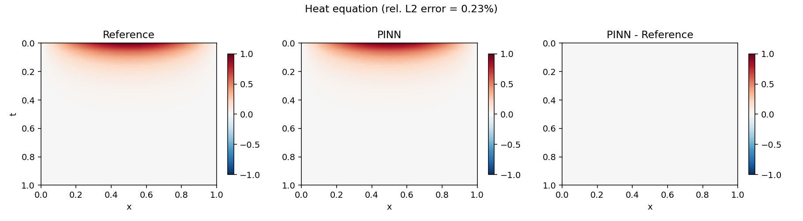
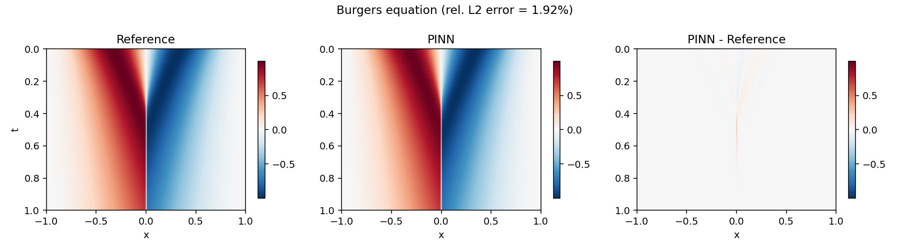
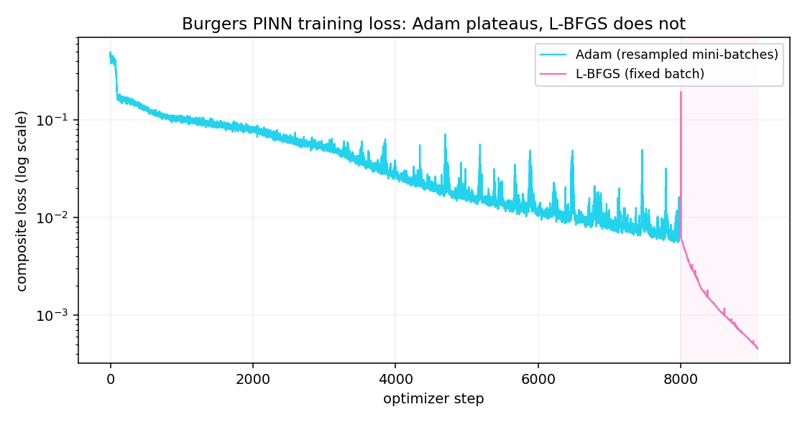

# Physics-Informed Neural Networks (PINNs)

[](https://github.com/crozol/04-pinns/actions/workflows/tests.yml)
[](https://opensource.org/licenses/MIT)
[](https://crozol.github.io/projects/04-pinns.html)

**TL;DR** — Two PDEs solved with physics-informed neural networks (Raissi, Perdikaris & Karniadakis, 2019): the loss combines the PDE residual, computed via automatic differentiation at collocation points, with the initial/boundary conditions — no mesh, no training data beyond those conditions. The 1D heat equation reaches **0.45% relative L2 error** against its exact analytical solution with Adam alone — a short L-BFGS pass pushes the frozen run shown here to **0.23%**. The 1D viscous Burgers equation (`nu = 0.01/pi`, the classic benchmark with a thin internal layer at `x = 0`) is harder: Adam alone plateaus at **~8.8%**, above target; following Raissi et al.'s own recipe — L-BFGS fine-tuning on top of Adam — brings it to **1.92%** against a Chebyshev-spectral numerical reference. Getting there surfaced a real, silent failure mode in naive L-BFGS + PINNs, documented in Section 5.4. Stack: PyTorch (autograd, `torch.optim.LBFGS`) · NumPy/SciPy (reference solutions) · Matplotlib.

The document walks through both cases in the order they were actually solved —
including the point where the obvious approach quietly didn't work — rather
than only presenting the final, polished numbers.

---

## Contents

1. [Objective](#1--objective)
2. [Equipment (software stack)](#2--equipment-software-stack)
3. [Background: what is a physics-informed neural network?](#3--background-what-is-a-physics-informed-neural-network)
4. [The heat equation](#4--the-heat-equation)
5. [The Burgers equation](#5--the-burgers-equation)
   - [5.1 · Formulation](#51--formulation)
   - [5.2 · The reference solution — why finite differences failed](#52--the-reference-solution--why-finite-differences-failed)
   - [5.3 · First attempt: Adam alone](#53--first-attempt-adam-alone)
   - [5.4 · Diagnosing the plateau — and a silent L-BFGS failure](#54--diagnosing-the-plateau--and-a-silent-l-bfgs-failure)
   - [5.5 · The fix and the final result](#55--the-fix-and-the-final-result)
6. [Head-to-head: why Burgers is harder](#6--head-to-head-why-burgers-is-harder)
7. [Reproducing](#7--reproducing)
8. [File map](#8--file-map)
9. [References](#9--references)

---

## 1 · Objective

Train a neural network `u_θ(x, t)` to satisfy a partial differential equation
directly — not by fitting it to a numerically-solved dataset, but by making
the PDE itself part of the loss function, evaluated via automatic
differentiation. Validate the result against a reference with no ambiguity
about ground truth: an exact analytical solution for the heat equation, and a
high-accuracy numerical solution for Burgers (which has none in closed form
for this initial condition).

## 2 · Equipment (software stack)

| Component | What it does in this experiment |
|---|---|
| Python 3.11+, PyTorch | The network and `torch.autograd.grad` for exact partial derivatives |
| `torch.optim.Adam` | First-order optimizer, resampled mini-batches every step |
| `torch.optim.LBFGS` | Second-order fine-tuning, strong-Wolfe line search |
| NumPy, SciPy (`solve_ivp`) | Chebyshev-spectral reference solution for Burgers |
| Matplotlib | Static figures |

No GPU is needed. Heat training takes a few minutes on a modern laptop CPU;
Burgers (Adam + L-BFGS) takes roughly 15.

## 3 · Background: what is a physics-informed neural network?

A PINN is a neural network `u_θ(x, t)` whose loss combines three pieces:

1. **Initial condition** — `u_θ(x, 0)` must match the known state at `t = 0`.
2. **Boundary condition** — `u_θ` must match known values at the edges of the
   spatial domain, for all `t`.
3. **PDE residual** — at randomly sampled interior points ("collocation
   points"), the PDE itself, evaluated using the network's own partial
   derivatives, should equal zero.

The key trick is `torch.autograd.grad(u, x, create_graph=True)`: since `u` is
the network's output and `x` is one of its inputs, this computes `∂u/∂x`
*exactly* (to float32 precision), not by finite differences — and because
`create_graph=True` keeps the computation differentiable, the same call can be
applied again to get `∂²u/∂x²`. This is why `pinn.py` uses `Tanh` activations
throughout: `ReLU` has a zero second derivative almost everywhere, which would
make any PDE residual involving a second-order term (both equations here)
collapse to a useless constant.

The network never sees a numerically-solved trajectory. Everything it learns
comes from the IC/BC data points and the PDE residual at randomly sampled
interior points — the physics *is* the training signal.

## 4 · The heat equation

`u_t = alpha · u_xx` on `x ∈ [0, 1]`, `t ∈ [0, 1]`, `alpha = 1`, with
`u(x, 0) = sin(pi x)` and `u(0, t) = u(1, t) = 0`. This is the textbook case:
separation of variables gives the exact solution in closed form,

```
u(x, t) = sin(pi x) · exp(-pi² alpha t)
```

a single decaying mode, smooth everywhere, nothing stiff or thin to resolve.
It is the sanity check that the PINN machinery — the residual, the autograd
chain, the composite loss — is wired correctly before attempting something
harder.

Adam, 5000 epochs, 10k collocation points, reaches **0.45% relative L2
error** on its own — already well past the <1% target, with no second-order
fine-tuning needed. The frozen run below adds a short L-BFGS pass anyway
(for consistency with the Burgers pipeline in `main.py`), which pushes it
further to **0.23%**:



The rightmost panel — the pointwise difference between the PINN and the
exact solution — is essentially blank. This is the case where the simplest
possible recipe already works.

## 5 · The Burgers equation

### 5.1 · Formulation

`u_t + u·u_x = nu·u_xx` on `x ∈ [-1, 1]`, `t ∈ [0, 1]`, `nu = 0.01/pi`, with
`u(x, 0) = -sin(pi x)` and `u(-1, t) = u(1, t) = 0` — the standard benchmark
from the original PINN paper (Raissi et al., 2019). The nonlinear advection
term `u·u_x` steepens the odd initial condition toward `x = 0` as `t`
increases; the small viscosity `nu` keeps the solution smooth but confines
that steepening to a thin internal layer rather than letting it form a true
discontinuity. There is no closed-form solution for this IC/BC.

### 5.2 · The reference solution — why finite differences failed

A reference was needed before any PINN result could be judged. The first
attempt was the obvious one: discretize `x` on a uniform grid, use central
differences for `u_x` and `u_xx`, and integrate in `t` with a stiff implicit
solver (`scipy.integrate.solve_ivp`, method `Radau`). On a 201-point grid the
integration ran in under a second — and produced `max|u| ≈ 1.51`.

That number is wrong on its own terms: `u_t + u·u_x = nu·u_xx` is a parabolic
PDE with no source term, so the maximum principle guarantees
`max|u(·, t)| ≤ max|u(·, 0)| = 1` for every `t`. An overshoot above `1` is not
a borderline numerical-error case — it is a sign the discretization itself is
invalid. The cause: `nu = 0.01/pi ≈ 0.00318` is small, so the internal layer
that forms near `x = 0` is only a few thousandths of a unit wide — thinner
than the grid spacing could resolve. A central-difference stencil on a
too-coarse grid produces exactly this kind of spurious oscillation (Gibbs-type
ringing) near a thin feature it cannot see clearly.

The fix was to stop discretizing locally. A **Chebyshev spectral method**
(`src/reference.py`) differentiates via a global polynomial interpolant
instead of a local stencil, so it does not need the grid to be locally finer
than the feature — spectral differentiation converges exponentially for
smooth functions regardless of where a sharp-but-smooth feature sits. With
`N = 256` points, the same maximum-principle check now gives `max|u| ≈ 0.9999`
— inside the physical bound, as it must be — and the solution is odd-symmetric
(`u(-x, t) = -u(x, t)`) and exactly zero at the boundaries to machine
precision, both properties guaranteed by the problem's symmetry and checked
directly in `tests/test_physics.py`.

### 5.3 · First attempt: Adam alone

Same recipe as the heat equation — Adam, 8000 epochs, 10k collocation points,
resampled every step — applied to the harder problem:

```
[epoch      0] loss=4.932933e-01
[epoch   4000] loss=2.744396e-02
[epoch   8000] loss=1.040192e-02   (final)
```

Evaluated against the spectral reference: **relative L2 error ≈ 8.8%** — above
the 5% target, and the loss curve (Section 6 has the full plot) is not
smoothly converging by the end; it oscillates around `~0.01` instead of
continuing to drop. Something was leaving real accuracy on the table.

### 5.4 · Diagnosing the plateau — and a silent L-BFGS failure

Raissi et al.'s original paper does not stop at Adam: it follows a first-order
warm-up with **L-BFGS**, a quasi-Newton method whose curvature information
lets it take much larger, better-aimed steps near a minimum than Adam's
per-parameter first-order updates can. `torch.optim.LBFGS` was added
(`src/train.py::refine_lbfgs`) and pointed at the already-Adam-trained model.

The first run of this looked like it worked — the closure reported a loss of
`6.46 × 10⁻³`, well below Adam's `1.04 × 10⁻²` — but the relative L2 error
against the reference came back **identical to 15 significant figures**
(`0.08827312736777508`, both times) to the pre-refinement number. The model
had not actually changed at all.

The cause: `torch.optim.LBFGS` with `line_search_fn="strong_wolfe"` searches
for a step size by evaluating the loss (and its gradient) at several candidate
points, and both the line search and the quasi-Newton Hessian approximation
assume the objective is a **deterministic** function of the parameters —
evaluating it twice at the same point must return the same value. The
training loop's `loss_fn`, by design, resamples a fresh batch of collocation,
boundary and initial points on *every* call (ordinary and correct for Adam's
stochastic mini-batch training). Under L-BFGS that same design turns the
objective into a noisy function: the line search's step-size probes see
different random realizations of the loss at each trial point, can never
reliably satisfy the Wolfe conditions, and the step is effectively rejected —
silently, with no exception, no warning, just an optimizer that reports an
interesting intermediate number and then changes nothing. The giveaway was
exactly that bit-for-bit-identical error: a coincidence that precise does not
happen from two different training runs landing on the same loss basin — it
happens when the parameters never moved.

### 5.5 · The fix and the final result

The fix: sample one large batch of collocation, boundary and initial points
**once**, before calling L-BFGS, and reuse that exact batch on every internal
evaluation of the closure during the refinement step. This makes the
objective deterministic for as long as L-BFGS runs, which is what both the
line search and the curvature estimate require (`src/train.py` — `train_heat`
and `train_burgers` both take an `lbfgs_iter` argument that triggers this
fixed-batch refinement after the stochastic Adam phase).

With that single change, 1000 L-BFGS iterations on a fixed batch of 40k
collocation / 800 boundary / 800 initial points:

```
[L-BFGS] final loss = 4.525385e-04
```



**Relative L2 error: 1.92%** (target was <5%), down from ~8.8% with Adam
alone. The error map (rightmost panel) is now concentrated almost entirely in
a thin vertical band right at the internal layer — exactly where the solution
is hardest to represent — rather than spread across the domain, which is the
qualitative signature of a method that is working correctly but running into
a genuinely hard local feature, not one that is broken.

## 6 · Head-to-head: why Burgers is harder



The heat equation's loss (not pictured — it simply decays smoothly to
`6.7 × 10⁻⁵` with Adam alone, then to `3.1 × 10⁻⁶` after the same short
L-BFGS pass) never *needed* the second optimizer the way Burgers did. Two
things make Burgers
different: the nonlinear `u·u_x` term couples every collocation point's
residual to the local value and slope of `u` itself, unlike the heat
equation's linear residual; and the thin internal layer concentrates nearly
all of the PDE's "information content" into a small region of the domain,
which first-order per-parameter updates are slow to resolve. Both are
well-documented properties of the Burgers benchmark in the PINN literature,
not an artifact of this particular implementation — which is exactly why
Raissi et al.'s original recipe already includes the L-BFGS stage this
project needed to rediscover.

## 7 · Reproducing

```bash
pip install -r requirements.txt
python main.py        # trains both models, saves figures/ and results/metrics.json
pytest tests/ -v       # fast correctness checks (no full training run)
```

Training is not bit-for-bit reproducible between runs — collocation points
are resampled every epoch by design, and no global seed is enforced beyond
`torch.manual_seed` at the start of each `train_*` call — so the numbers above
are from one frozen run, consistent with how the rest of this portfolio
treats stochastic training. Expect run-to-run variation at the percent level
on Burgers, not a qualitative change in the conclusions above.

| Stage | Time (CPU) |
|---|---|
| Heat (Adam, 5000 epochs) | ~6 min |
| Burgers (Adam, 8000 epochs) | ~9 min |
| Burgers (L-BFGS, 1000 iters, fixed batch) | ~7 min |

## 8 · File map

```
04-pinns/
├── README.md
├── LICENSE
├── CITATION.cff
├── requirements.txt
├── main.py              # full pipeline: train, validate, save figures + metrics.json
├── src/
│   ├── pinn.py            # u_theta(x, t) — MLP with Tanh activations (twice-differentiable)
│   ├── physics.py         # PDE residuals (heat, Burgers) + exact heat solution
│   ├── reference.py        # Chebyshev-spectral numerical reference for Burgers
│   └── train.py            # Adam training loop + fixed-batch L-BFGS fine-tuning
├── scripts/
│   └── export_json.py       # arrays -> JSON for the portfolio page's interactive charts
├── tests/                  # pytest: residual correctness, reference sanity, training smoke test
└── figures/                 # PINN-vs-reference comparison plots + loss curve (tracked)
```

## 9 · References

- Raissi, M., Perdikaris, P., & Karniadakis, G. E. (2019). *Physics-informed
  neural networks: A deep learning framework for solving forward and inverse
  problems involving nonlinear partial differential equations.* Journal of
  Computational Physics, 378, 686-707.
- Trefethen, L. N. (2000). *Spectral Methods in MATLAB.* SIAM. (Chebyshev
  differentiation matrices, used in `src/reference.py`)
- Liu, D. C. & Nocedal, J. (1989). *On the limited memory BFGS method for
  large scale optimization.* Mathematical Programming, 45, 503-528.
  (L-BFGS, used in the fine-tuning stage)
